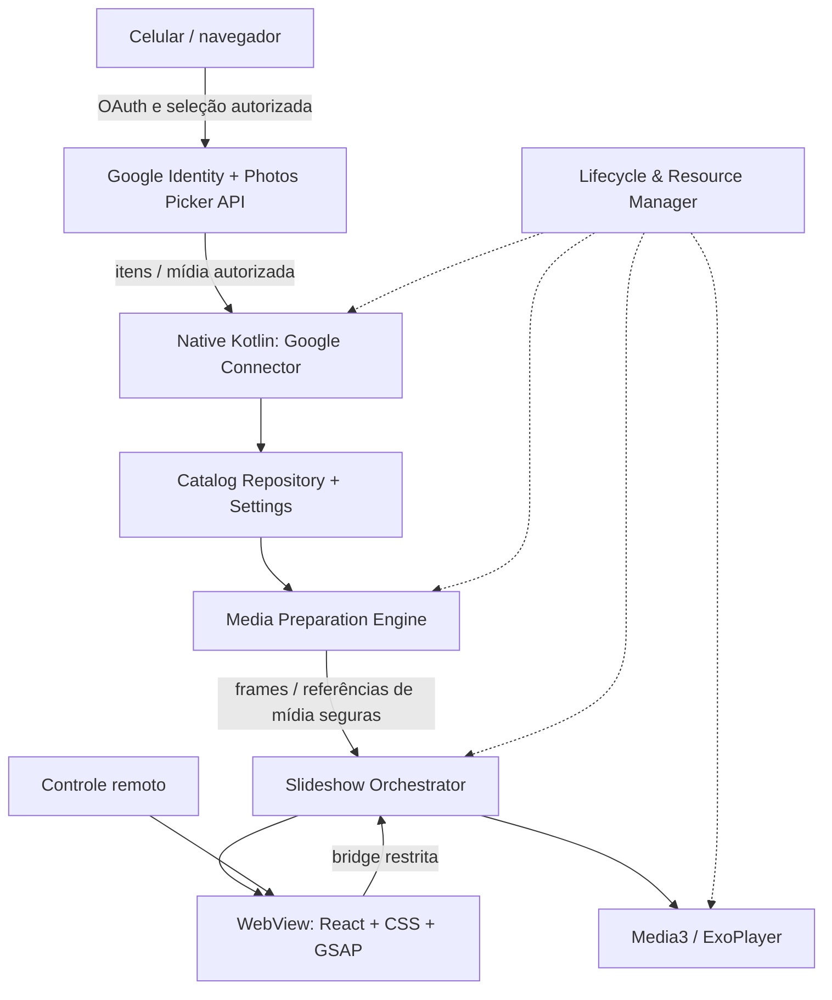
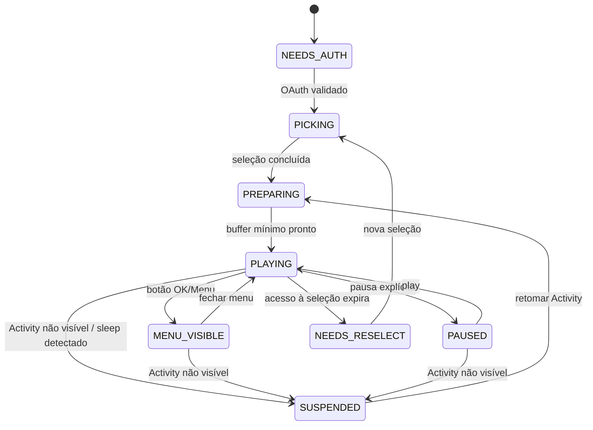

# PRD estendido — Memora

> **Status:** protótipo visual aprovado; incremento demonstrativo instalável concluído e validado no alvo; implementação do MVP ainda não iniciada
> **Versão:** 0.8 · **Data:** 2026-10-25 · **Idioma:** português (termos técnicos em inglês)
> **Artefato:** PRD + Technical Design preliminar + ADRs + plano de validação  
> **Dispositivo-alvo:** Amazon Fire TV Stick 4K Max, 2ª geração (2023), Fire OS 8 / base Android 11  
> **Leitor principal:** desenvolvedor responsável e agentes de codificação (Codex CLI)

## Legenda e regras de interpretação

- **[DECIDIDO]** Requisito ou diretriz expressamente escolhida.
- **[PROPOSTO]** Recomendação arquitetural, sujeita a experimentação.
- **[VALIDAR]** Hipótese não comprovada; **não implementar como se fosse garantida**.
- **[FUTURO]** Ideia fora do MVP ou dependente de aprovação futura.
- **[BLOQUEADOR]** Condição que precisa de evidência antes de comprometer a arquitetura/roadmap.
- Prioridades: **P0** (essencial), **P1** (importante), **P2** (desejável).
- O agente deve separar requisito do produto, decisão técnica e hipótese da plataforma; não inferir capabilities não documentadas do Google Fotos.

---

## 1. Resumo executivo

**Nome do produto:** **Memora**. [DECIDIDO] Nome oficial do projeto e da aplicação.

Construir um aplicativo Android, distribuído como **APK** e instalado diretamente via **ADB**, que transforme a TV em uma moldura digital cinematográfica, exibindo continuamente **fotografias e vídeos residentes no Google Fotos**. A interface deve criar composições dinâmicas — especialmente o pareamento de duas fotos verticais, mosaicos de múltiplas fotos e transições animadas — com menus acessíveis pelo controle remoto, informações de data/hora e local quando disponíveis e consumo eficiente de memória, rede e API.

**Google Fotos é a origem obrigatória do acervo.** Não aceitar soluções que demandem migração completa para NAS, Google Drive, biblioteca local ou duplicação permanente do acervo. Pequeno cache transitório para renderização é aceitável.

**Principal risco de viabilidade:** a Google Photos Picker API fornece acesso a conteúdo explicitamente selecionado pelo usuário **durante sessões temporárias**, não um catálogo permanente e irrestrito de álbuns. Antes de prometer slideshow indefinido de todo o acervo, a POC precisa validar as regras efetivas de acesso e uma UX aceitável de reautorização. O sucesso observado no app terceiro TV Gallery é evidência de viabilidade da seleção, **não** prova de acesso perpétuo.

## 2. Problema, motivação e objetivos

### 2.1 Problema

A biblioteca pessoal está no Google Fotos, incluindo imagens históricas, vídeos e Live Photos capturadas sobretudo no iPhone e sincronizadas pelo aplicativo Google Fotos. Aplicativos testados são insuficientes: oferecem integração útil, porém visualização simplista, ou experiências visuais ricas sem integração adequada, ou exigem cópias locais/pagamento.

### 2.2 Objetivos

- **OBJ-01 [P0]** Usar Google Fotos como fonte primária de fotos/vídeos.
- **OBJ-02 [P0]** Iniciar e manter slideshow contínuo sem interação recorrente durante a sessão válida.
- **OBJ-03 [P0]** Exibir mais de uma foto simultaneamente conforme orientação/proporção e produzir transições elegantes.
- **OBJ-04 [P0]** Operar com controle remoto, sem teclado/mouse nem smartphone após o onboarding.
- **OBJ-05 [P0]** Minimizar chamadas à API e transferência de mídia; sem espelhamento integral da biblioteca.
- **OBJ-06 [P0]** Proteger credenciais e reduzir exposição de dados pessoais.
- **OBJ-07 [P1]** Integrar vídeo e explorar componente de movimento de Live Photos.
- **OBJ-08 [P1]** Apresentar informações da captura (data/hora; localização apenas quando fundamentada).
- **OBJ-09 [P1]** Instalar, atualizar e debugar localmente pelo Codex CLI usando ADB.

### 2.3 Público e contexto

Uso pessoal, inicialmente em **um Fire TV Stick 4K Max 2ª geração**. TV widescreen, navegação D-pad, uso prolongado e frequente em modo apresentação. Sem necessidade inicial de publicação em loja, multiusuário comercial, assinaturas ou monetização.

### 2.4 Fora do escopo inicial

Marketplace/publicação Amazon Appstore, suporte a Vega OS, sincronizar cópia integral, editar/remover fotografias no Google, reconhecimento de presença física por câmera, backend SaaS obrigatório, IA de geolocalização automática sem confirmação, recurso de screensaver global do sistema, suporte pleno a todos os televisores/modelos.

---

## 3. Descobertas e restrições verificadas

### 3.1 Google Photos Picker API

- Requer projeto Google Cloud, API habilitada e OAuth 2.0, com escopo `https://www.googleapis.com/auth/photospicker.mediaitems.readonly`.
- `sessions.create` retorna `pickerUri`, que pode ser mostrado por QR Code no celular para **seleção do conteúdo**. **QR Code do Picker não equivale por si só ao login OAuth da TV.**
- A sessão é consultada segundo `pollingConfig`; ao concluir, `mediaItems.list` retorna os itens selecionados, com paginação.
- Sessões têm `expireTime` e acesso às mídias vinculado à sessão. `PickingConfig.maxItemCount`: **máximo 2.000 itens por sessão** na documentação REST atual.
- IDs dos itens são descritos como persistentes para identificação entre sessões, **mas isso não significa autorização permanente** para recuperar seus bytes após expiração.
- `baseUrl` da mídia costuma durar **60 minutos** e exige Bearer OAuth válido; renovar OAuth não torna automaticamente reutilizável um `baseUrl` expirado.
- Fotos: parâmetros de resolução; `=d` pode recuperar EXIF **sem informação de localização**. Vídeos: `=dv` para bytes de versão transcodificada, sujeito a `processingStatus=READY`. Motion Photos: documentação permite recuperar componentes estático e de vídeo; caso iPhone Live Photo específico precisa teste.
- Metadados disponíveis incluem `createTime`, orientação via largura/altura, MIME, câmera e propriedades técnicas. Não há localização GPS/cidade nativa no modelo Picker.
- O Picker **não oferece endpoint irrestrito para listar álbuns existentes**, nem fluxo documentado de sincronização automática de novidades no acervo.
- Quotas publicadas no momento da consulta: **100.000 requests/min/projeto** para Picker e **1.000.000 requests/min/projeto** para bytes de mídia. São limites, não metas de consumo; revalidar em produção.

**Documentação:**
- https://developers.google.com/photos/picker/guides/get-started-picker
- https://developers.google.com/photos/picker/guides/sessions
- https://developers.google.com/photos/picker/reference/rest/v1/sessions
- https://developers.google.com/photos/picker/guides/media-items
- https://developers.google.com/photos/picker/reference/rest/v1/mediaItems
- https://developers.google.com/photos/overview/authorization
- https://developers.google.com/photos/overview/configure-your-app
- https://developers.google.com/photos/overview/api-limits-quotas

### 3.2 OAuth e QR Code [BLOQUEADOR]

O fluxo OAuth 2.0 “TVs and Limited-Input Devices” do Google limita expressamente os **escopos permitidos** e **não inclui** `photospicker.mediaitems.readonly` na lista consultada. Assim, **não pressupor** que Device Authorization Grant oficial funcione com Picker.

Investigar uma arquitetura segura, conforme políticas do Google, que permita OAuth com PKCE via celular/navegador e transferir a autorização de modo apropriado ao APK, **sem transferir token por QR Code exposto**, sem embutir client secret no APK e sem backend permanente se possível. Pode haver necessidade de um serviço temporário de pareamento autenticado; registrar justificativa e custos. O `pickerUri` é etapa posterior/diferente da autorização OAuth.

Referência: https://developers.google.com/identity/protocols/oauth2/limited-input-device

### 3.3 Fire OS e UI

Fire OS 8 é baseado em Android 11 e aceita **APK sideload por ADB** com depuração habilitada. A UX pode ser implementada com **Kotlin + Android WebView**, frontend React compilado e incluído no APK. Validar versão real do WebView/Chromium e suporte ao Tailwind v4 e efeitos; se incompatível, fixar Tailwind v3.4 ou alternativa de CSS. `FLAG_KEEP_SCREEN_ON` pode evitar suspensão de tela enquanto a Activity está visível, mas não garante identificar desligamento físico da TV ou presença humana.

O host demonstrativo e o frontend compartilhado concretizam a origem local e a política de navegação;
consulte [host e baseline](02-host-android-e-baseline.md#1-host-e-fronteira) antes
de alterá-los e o [baseline em leitura](02-host-android-e-baseline.md#3-baseline-em-leitura)
antes de escolher o target do frontend. Essas consultas não encerram SPK-06.

### 3.4 Evidências empíricas de aplicativos similares

- **TV Gallery for Google Photos:** testado no próprio Fire TV; autenticação/conexão, seleção e visualização de vários álbuns funcionaram para o usuário; apresentação limitada a uma foto por vez, sem vídeos segundo descrição do autor. Solução de referência de UX, não prova de arquitetura interna.
- **PhotoGuru:** instalado, versão observada 7.5.0.52507; lista de provedores não exibia Google Fotos, inclusive no menu de adicionar pastas. Não adotar como dependência.
- **PixFolio:** oferece efeitos e vídeos, mas modelo comercial e comportamento de obtenção/cache não atendem claramente ao objetivo.
- **Pixette e semelhantes:** mais ricos visualmente, mas sem integração nativa direta ao Google Fotos em condições desejadas.
- **Google Photos Ambient API:** conceitualmente adequada para TVs, porém acesso de parceiros; não incluir como dependência do MVP pessoal sem elegibilidade confirmada.

---

## 4. Requisitos funcionais

| ID | Pri. | Requisito | Critério de aceite inicial |
|---|---|---|---|
| FR-001 | P0 | Onboarding OAuth Google com autorização explícita | Fluxo completado com usuário de teste sem senha no APK; falhas explicadas; mecanismo previamente validado com escopo Picker |
| FR-002 | P0 | Mostrar QR Code/URL para abrir Picker no celular | URL correta no celular; sessão monitorada respeitando intervalos; timeout tratado |
| FR-003 | P0 | Importar seleção autorizada de fotos/vídeos e metadados | Paginação correta, duplicatas tratadas, limites de 2.000 indicados |
| FR-004 | P0 | Exibir coleções selecionáveis no app | Usuário liga/desliga coleções locais; não alegar listar todos os álbuns da nuvem sem evidência |
| FR-005 | P0 | Slideshow contínuo automático | Reprodução prossegue em loop enquanto há mídia válida, sem necessidade de comando entre slides |
| FR-006 | P0 | Parear duas fotos verticais | Ao receber duas imagens de retrato apropriadas, renderiza lado a lado sem distorção |
| FR-007 | P0 | Composições dinâmicas de 1–N fotos | Pelo menos layouts individual, 2 retratos e mosaico assimétrico; seleção baseada em proporção |
| FR-008 | P0 | Transições suaves | Fade, pan/zoom Ken Burns e transição entre composições sem piscadas sob condições de teste definidas |
| FR-009 | P0 | Menu overlay via controle remoto | OK/Menu abre controles; Voltar fecha; slideshow não é reiniciado indevidamente |
| FR-010 | P0 | Configurar álbuns/coleções ativas | Preferências persistem entre reinícios e refletem na próxima seleção de mídia |
| FR-011 | P0 | Configurar timing e shuffle | Duração, ordem/aleatório, velocidade e estilos ajustáveis e persistentes |
| FR-012 | P0 | Pré-carregamento e cache transitório | Próximas mídias prontas sob rede normal, sem download da biblioteca toda |
| FR-013 | P0 | Recuperação de erros de rede/OAuth/sessão expirada | Retry limitado, mensagens e retomada; nunca loop infinito agressivo |
| FR-014 | P1 | Reproduzir vídeos convencionais | Vídeo `READY` toca com áudio configurável; erro/codec não paralisa fila |
| FR-015 | P1 | Suporte a Live Photos / Motion Photos | Teste com mídia real iPhone sincronizada; animação do trecho quando recuperável |
| FR-016 | P1 | Overlay de metadados | Data/hora corretas quando conhecidas; fuso/ausência tratados; local somente se fundamentado |
| FR-017 | P1 | Administração das seleções | Adicionar novas seleções, nomear coleções, excluir registros locais, revisar autorizações |
| FR-018 | P1 | Retomar sessão de uso após reabertura | Preferências e catálogo local sobrevivem; se reautorização exigida, UX explícita e rápida |
| FR-019 | P1 | Diagnósticos acessíveis | Tela técnica opcional com status OAuth, sessão, cache e contadores, sem tokens |
| FR-020 | P2 | Enriquecer localização | Metadados Takeout ou tags manuais por coleção; exibir fonte/confiança |
| FR-021 | P2 | Variantes cinematográficas avançadas | Storyboard, collage, layouts temáticos e coreografia elaborada |
| FR-022 | P2 | Personalizar overlays | Alternar relógio atual, data da foto, informação de câmera e local |

### 4.1 Semântica de “álbuns” e “coleções” [VALIDAR]

O produto deseja escolher **álbuns do Google Fotos** para reprodução. A integração oficial só garante itens explicitamente selecionados; ela não garante que a API devolva a associação do item aos álbuns originais. Definir separadamente:

1. **Álbum do Google Fotos:** coleção mantida no serviço, cuja listagem via Picker não é garantida.
2. **Seleção Picker:** itens consentidos numa sessão, com validade delimitada.
3. **Coleção local:** grupo nomeado pela aplicação a partir de uma ou mais seleções; pode ser ativado/desativado no slideshow.

Não prometer “sincronização automática de álbum” no MVP. A POC deve estabelecer se a UX de seleção por álbum no celular permite persistir suficiente informação sem ultrapassar 2.000 itens/sessão.

### 4.2 Fluxo de interação [PROPOSTO]

1. Primeira inicialização: verificar autorização → exibir passo de OAuth compatível → iniciar sessão Picker → mostrar QR Code.
2. No celular: usuário autentica e seleciona imagens/álbuns disponíveis na UI do Google, conclui seleção.
3. TV: importa itens, permite nomear e ativar coleções locais.
4. Inicia autoplay; interface some, fotos aparecem em diferentes composições.
5. OK/Menu: overlay de pausa, próximo/anterior, coleções, preferências, atualização de seleção e diagnósticos.
6. Voltar: fecha overlay; eventualmente retoma reprodução.
7. Perda de autorização ou fim do acesso: pausar preparação, mostrar CTA de nova autorização/seleção; **não dar falsa impressão de streaming permanente**.

---

## 5. Requisitos não funcionais

| ID | Pri. | Requisito | Estratégia inicial de verificação |
|---|---|---|---|
| NFR-001 | P0 | Segurança OAuth | Sem client secret no APK; tokens não expostos ao React/JS/Logcat; criptografia e revogação |
| NFR-002 | P0 | Isolamento WebView | Bridge restrita, navegação permitida sob allowlist, `addJavascriptInterface` somente para origem confiável e métodos mínimos |
| NFR-003 | P0 | Memória delimitada | Medir RAM nativa + WebView + heap de imagens; cache com limite rígido configurável após benchmark |
| NFR-004 | P0 | Rede/API econômicas | Nunca fazer polling contínuo fora do Picker ativo; memoização, batch/paginação, backoff e deduplicação |
| NFR-005 | P0 | Lifecycle correto | Ao perder visibilidade/atividade, parar player, downloads e requisições não essenciais; retomar conscientemente |
| NFR-006 | P0 | Evitar standby em reprodução visível | Aplicar `FLAG_KEEP_SCREEN_ON` apenas em PLAYING/MENU_VISIBLE, retirar ao pausar/background |
| NFR-007 | P0 | Resiliência | Offline/401/403/429/5xx e expiração não causam crash nem retry storm |
| NFR-008 | P1 | Fluidez em 4K | Medir FPS, frames perdidos, tempo de troca e travamentos no hardware; estabelecer metas após baseline |
| NFR-009 | P1 | Privacidade | Nenhum envio de fotos a servidores próprios; cache efêmero e limpeza sob solicitação; GPS não inventado |
| NFR-010 | P1 | Observabilidade | Métricas locais de hit rate, requests por sessão/min, erros, consumo de memória e latência |
| NFR-011 | P1 | Manutenção | Separação por módulos, testes de contratos e reprodução com mocks de API/arquivos |
| NFR-012 | P1 | Custo operacional | Objetivo de R$ 0/mês sem backend pago; validar necessidade de infraestrutura de pareamento |

**Não definir metas quantitativas arbitrárias antes da medição real.** Valores de RAM, cache, FPS e timeouts serão validados na POC e versionados aqui.

---

## 6. Arquitetura lógica proposta

**Formato físico:** um APK Android em um único processo/aplicação (com WebView possivelmente multiprocesso internamente). Separação por módulos lógicos e tarefas assíncronas; **não** criar microserviços nem serviço Android sempre ativo sem necessidade.

### 6.1 Módulos

**M1 — Auth & Google Connector (Kotlin)**  
OAuth, estado de autorização, criação/polling/remoção de sessões, paginação, download HTTP autenticado de mídia, rate limits, reconexão, status de expiração. Não expor token bruto à UI.

**M2 — Catalog & Settings (Kotlin)**  
Banco leve local (candidato: Room) para itens selecionados, IDs persistentes, dimensões, createTime, estado de coleção, preferências; **não armazenar `baseUrl` como endereço permanente**. Esquema preparado para registros expirados/revalidação e origem da localização.

**M3 — Media Preparation Engine (Kotlin)**  
Fila assíncrona bounded, cache de imagens/miniaturas em disco e RAM, decode/downsample em resolução útil, limitação de concorrência, reuso de quadros, cancelamento e eviction LRU. Potenciais ferramentas: OkHttp/Ktor, coroutines/Flow; Coil/Glide (avaliar compatibilidade WebView/bridge). Cache sempre sujeito às políticas Google e consentimento.

**M4 — Slideshow Orchestrator (Kotlin ou TS, definir por POC)**  
Máquina de estados, seleção de cenas, shuffle, duração, troca entre foto/vídeo, tratamento de erros, sincronização com eventos nativos. Recomendado manter **fonte de verdade única** sobre playback; regras puras de composição podem residir em TypeScript.

**M5 — Presentation Engine (React + TypeScript no WebView)**  
Vite empacotado no APK, Tailwind CSS, GSAP/Flip, CSS Grid, React Photo Album quando útil; overlay e navegação por D-pad; composições renderizadas sem credenciais OAuth. Yet Another React Lightbox como opção para modo de foto individual, não dependência obrigatória.

**M6 — Lifecycle & Resource Manager (Kotlin)**  
Observa estado da Activity, visibilidade, screen on/off e eventos da plataforma disponíveis; cancela filas quando apropriado e atualiza `FLAG_KEEP_SCREEN_ON`. Não equiparar tela ligada à presença humana.

### 6.2 Decisões de fronteira importantes

- Bridge entre WebView e Kotlin com contrato pequeno, tipado e auditável; evitar permitir URLs arbitrárias ou repassar tokens ao JavaScript.
- Conteúdo carregado pelo WebView deve usar estratégia segura de acesso local/virtual aos bytes, a definir (ex.: `WebViewAssetLoader` para assets, e endpoint/interceptação autorizada para mídia). **Não** hardcodar `baseUrl` autenticado no DOM.
- Reprodução de vídeos preferencialmente nativa Media3/ExoPlayer; integrar visualmente à cena WebView exige validar sincronização e layering/surface. Se complexo, avaliar HTML5 video em WebView com benchmarking de codecs.
- A preparação de mídia opera concorrente à renderização, mas respeita o ciclo de vida da Activity e não constitui daemon independente.

---

## 7. Modelo de estados e ciclo de vida

- `PLAYING`: `KEEP_SCREEN_ON` habilitado; requisições sob demanda e buffer deslizante.
- `MENU_VISIBLE`: decidir se slideshow prossegue reduzido ou pausa; impedir que menus disparem downloads desnecessários.
- `PAUSED`: parar consumo de mídia; remover manutenção de tela ligada após critério acordado.
- `SUSPENDED`: cancelar jobs, interromper media player e requisições de fundo; não prometer detectar toda mudança HDMI/TV desligada.
- `NEEDS_RESELECT`: informar claramente por que o acesso acabou; não tentar contornar autorização do Google.

O incremento demonstrativo concretiza estados e eventos no
[contrato de lifecycle da TV](02-host-android-e-baseline.md#5-controle-persistência-e-lifecycle-da-tv).
Consultar antes de alterar o host ou playback; implementação e testes locais não
equivalem ao aceite de hardware da etapa I3.

## 8. Algoritmo de apresentação visual

Para propostas de identidade, menus, foco e exploração no navegador, consulte
[Identidade visual e laboratório de experiência](01-identidade-visual-e-ux.md#2-registro-de-decisões-e-hipóteses).
O documento detalha os estudos sem substituir os requisitos e gates deste PRD.

### 8.1 Composition Engine [PROPOSTO]

Recebe itens com proporção, dimensões, timestamps e tipo; gera `Scene` com `slots`, crop policy, overlay e transição.

Regras iniciais:

1. **Single landscape** — foto horizontal em destaque, `contain` ou `cover` configurável.
2. **Portrait pair** — duas fotos verticais lado a lado sem distorção, com crop mínimo e fundo adaptativo.
3. **Hero + supporting** — horizontal principal acompanhada de 1–3 fotos menores.
4. **Justified/masonry** — galeria com distribuição conforme dimensões; sem “buracos” visuais agressivos.
5. **Video scene** — prioridade de legibilidade, áudio e reprodução contínua; não sobrepor transições pesadas.
6. **Live Photo scene** — estática → breve movimento → próxima cena, somente se o componente de vídeo estiver disponível.

Critérios opcionais futuros: afinidade temporal, eventos, nomes de coleção, retratos agrupados, detecção de imagens semelhantes; nunca inventar local.

### 8.2 Motion & styling

- **React + TypeScript + Vite**; **Tailwind** para design system, tipografia, menus e espaçamentos.
- **GSAP + Flip** para animação de reorganização de layout, timelines e transições.
- **React Photo Album** como algoritmo de layout para mosaicos; composição curada por nosso engine onde a biblioteca não cobre necessidades.
- **Swiper** e **Yet Another React Lightbox** como alternativas pontuais; não instalar ambos sem justificativa.
- Preferir animações `transform` e `opacity`; evitar recalcular layout por frame, excesso de blur/filtros, DOM com dezenas de fotos 4K simultâneas.
- Validar suporte real do WebView a Tailwind v4; v3.4 é fallback.

### 8.3 Metadados de apresentação

- `createTime` oferece data/hora associada ao registro da mídia, porém fuso original/local de captura pode não estar preservado; não converter indiscriminadamente para fuso atual da TV e alegar ser hora local da captura.
- O relógio **atual** da TV é distinto da **hora da captura**; rótulos claros.
- GPS é omitido pela API Picker e pelo download `=d`; Android Photo Picker é componente diferente e **não resolve** esta integração REST.
- Alternativas futuras: importar **somente JSON/metadados** de Google Takeout, mapear local manual por coleção, ou identificar local aproximado por IA com origem e grau de certeza explícitos.
- Imagens do iPhone podem ter Live Photo, mas verificar representação após backup no Google Fotos com amostras reais.

---

## 9. Cache, política de rede e custos

### 9.1 Fluxo bounded

- Criar catálogo leve de itens selecionados; **não replicar** mídia em massa.
- Manter buffer deslizante em torno da cena corrente (ex.: atual + 2 próximas, sujeito à memória). Duas ou mais fotos por cena alteram cardinalidade do buffer.
- Solicitar thumbs e resoluções adequadas ao slot, idealmente evitando decodificação desnecessária em resolução original.
- Aplicar LRU em disco efêmero com limite em bytes; cache RAM com limite menor; limpar em logout e sob solicitação.
- Deduplicar downloads concorrentes do mesmo item, limitar conexões, respeitar `Retry-After` e backoff exponencial com jitter em 429/5xx.
- Usar `pollingConfig` apenas durante sessão Picker pendente. **Não** pollar a API continuamente como mecanismo de descoberta de fotos novas.
- Cache e catálogo não equivalem a direito permanente de acessar um item após expiração da sessão; verificar retenção permitida pelas políticas Google.

### 9.2 Telemetria local mínima

`requests_total`, `media_bytes`, `429_count`, `oauth_refresh_count`, `picker_sessions`, `cache_hit_ratio`, `cache_size_bytes`, `decode_ms`, `scene_prepare_ms`, `frame_jank`, `app_heap_bytes`, `webview_memory_proxy`, `video_errors`, `lifecycle_transitions`.

Não registrar foto, token, GPS, `pickerUri` ou URL de mídia em logs. Telemetria local, desativável e sem upload externo por padrão.

### 9.3 Custo

Google Photos Picker API disponibilizada sem preço por requisição informado nos guias consultados; quotas não são cobrança. Objetivo de operar sem backend pago e sem infra recorrente. **Se o fluxo OAuth/QR exigir serviço remoto, reavaliar custo, segurança e deploy antes de aprovar.**

---

## 10. Segurança e privacidade

- OAuth 2.0/PKCE com cliente apropriado; não capturar senha Google; **não embutir client secret confidencial no APK**.
- Minimized scope: `photospicker.mediaitems.readonly`.
- Token de acesso sensível mesmo temporário; refresh token, se houver, sensível e rotacionável/revogável.
- Armazenar chaves no Android Keystore quando aplicável; criptografar material persistente e restringir backup/exportação de dados sensíveis; não afirmar que Keystore protege token em uso contra aparelho comprometido.
- JS/WebView opera sem tokens; requests autenticados gerenciados pela camada nativa.
- Aplicar HTTPS, validação de URL/origem, política de navegação e proteção da ponte JS nativa.
- Usuário pode revogar acesso via Conta Google; aplicação oferece logout, limpeza de dados/cache e reset de seleção.
- Localização e horário de captura podem ser incompletos; informações inferidas recebem indicação.
- Avaliar política de Google Photos API User Data/Developer Policy para cache, retenção e visualização de conteúdo após sessão.
- **[VALIDAR] Enquadramento do uso:** a [política Photos](https://developers.google.com/photos/support/api-policy), consultada em 2026-10-25, restringe substitutos do Google Fotos, incluindo galerias genéricas. Avaliar o uso específico do Memora antes de testar dados reais; não concluir permissão ou proibição do projeto apenas pela descrição de moldura digital.

---

## 11. Estratégia de entrega e experimentação

### Fase 0 — Spike técnico, **gate de viabilidade obrigatório**

Em paralelo ao planejamento dos spikes, está autorizada a exploração visual
isolada em browser com dados mock. Consulte o
[recorte e os critérios do protótipo](01-identidade-visual-e-ux.md#8-tarefa-executável-e-critérios-de-revisão)
antes de trabalhar em `apps/prototype`. Esse laboratório não implementa a UX
final do APK, não demonstra viabilidade da integração e não dispensa os gates abaixo.

**Incremento demonstrativo instalável [DECIDIDO]:** antes do MVP integrado,
validar a experiência embarcada e o pipeline local de entrega com mídia mock.
Consultar o [plano da primeira versão instalável](plans/01-primeira-versao-instalavel.md#2-recorte-aprovado)
para o recorte aprovado, a sequência de issues, o versionamento e as evidências
de instalação/atualização. A entrega é uma exceção delimitada à exploração em
browser: permite preparar e validar o host e a apresentação demonstrativa no
dispositivo, preservando os gates de integração Google e a condição de não
implementar a UX final de acesso ao acervo antes da viabilidade.

O incremento demonstrativo foi concluído. Consultar a
[central de progresso e evidências](plans/01-primeira-versao-instalavel.md#5-central-de-progresso)
antes de usar seus resultados: comprova o ciclo de entrega e atualização no
recorte local, com limites explícitos. Fornece evidência parcial de plataforma;
não encerra SPK-06 nem os gates Google e não autoriza iniciar o MVP integrado.

O [plano de viabilidade Google](plans/02-viabilidade-google-fotos.md) foi
aprovado para execução; consultar sua central para andamento e evidências.
Seu [registro de fontes e evidências](04-viabilidade-google-fotos.md) distingue
pesquisa documental de testes ainda não realizados.

**SPK-01 OAuth:** provar um fluxo de autorização legítimo que funcione com o escopo Picker em Fire TV; separar autenticação de `pickerUri`; documentar se requer backend.

**SPK-02 Picker:** selecionar 10 fotos + 2 vídeos, verificar metadados reais, URLs, download e status.

**SPK-03 Persistência:** fechar/reiniciar app, aguardar expiração de sessão e de `baseUrl`, testar se algum caminho oficial revalida/reacessa mídia sem reescolha; registrar explicitamente o resultado.

**SPK-04 Álbuns/escala:** escolher álbum com >2.000 itens, avaliar experiência e limite; verificar se associação a álbum é exposta para o app.

**SPK-05 Vídeos e iPhone:** reproduzir vídeo padrão e Live Photo real no Fire Stick; testar `=dv` e comportamento de streaming/seek sem exigir arquivo completo quando tecnicamente permitido.

**SPK-06 Plataforma:** instalar APK, inspecionar WebView/Chromium e medir renderização de duas fotos verticais + 4 fotos em mosaico com GSAP.

**Critério de saída:** demonstrar uma UX aceitável de acesso recorrente ao acervo. Se não houver caminho oficial persistente, **registrar limitação do produto antes de iniciar MVP**; não contornar por scraping ou API privada sem decisão expressa e análise de riscos.

### Fase 1 — MVP

- APK assinado para instalação local, OAuth/Picker operacional e seguro.
- Catálogo de seleções/coleções gerenciável; metadados essenciais.
- Slideshow contínuo, random/ordenado, single + portrait pair + mosaico simples.
- Menu sobreposto com D-pad, configurações persistentes, pausa/próxima.
- Cache bounded, lifecycle e tratamento de expiração/erros.
- Métricas e logs locais úteis.

### Fase 2 — Evoluções

Vídeos no fluxo principal se não integrarem MVP, Live Photos, montagens elaboradas, GSAP Flip avançado, exibição refinada de captura/local, importação opcional de metadados Google Takeout, presets visuais e customização.

### Fase 3 — Opcional

Perfis múltiplos, instalação/distribuição para outras TVs Android, screensaver integrado ao sistema se suportado, suporte a outras plataformas, IA com opt-in.

---

## 12. Estratégia de desenvolvimento, testes e deploy

- Repositório com módulo Android Kotlin/Gradle e frontend React/TS/Vite.
- Build frontend gera assets estáticos incorporados ao APK; sem servidor web remoto para renderização.
- Codex CLI executa Gradle, testes, build, `adb connect <IP>:5555`, `adb install -r <arquivo.apk>`, inicialização, `adb logcat` e coleta de métricas; passos/segredos fora do código-fonte.
- Unit tests Kotlin: contratos Google, estados, caching, limites, retry e repositórios.
- Unit/component tests TS: algoritmos de composição, snapshots de layout, eventos de controle remoto.
- Integration tests com mock da Picker e mídia sintética; smoke test no Fire Stick real.
- Conjuntos reais mínimos consentidos: foto horizontal, duas verticais, 4+ imagens, mídia iPhone HEIC/JPEG, vídeo, Live Photo e timestamps de diferentes fusos.
- QA: baixa conexão, interrupção Wi-Fi, fechar/retomar app, cancelar Picker, sessão expirada, OAuth revogado, vídeo falho, cache saturado, controle Back/Menu/OK.
- Guardrails: nunca usar credenciais reais em fixtures/commits/CI, nem logs sensíveis.

O empacotamento demonstrativo local tem implementação própria; consultar
[entrega Android](03-entrega-android.md#1-configuração-e-fronteiras) antes de
alterar versão, assinatura ou verificação e o
[README](../README.md#empacotamento-local-da-release) para os comandos executáveis.

### Layout de repositório implementado

Consultar o [host e a fronteira concreta](02-host-android-e-baseline.md#1-host-e-fronteira)
antes de criar módulos ou reorganizar diretórios. Aplicações e workspaces npm
ficam em `apps/`, inclusive código compartilhado em `apps/shared/presentation`.
Configuração npm, lockfile e dependências geradas também ficam em `apps/`, sem
`node_modules/` ou `packages/` na raiz. Consulte o
[README](../README.md#frontend-demonstrativo-de-tv) para instalação e comandos.
Ferramentas locais ficam em `tools/` e documentação em `docs/`.

---

## 13. ADRs resumidos

| ADR | Decisão / recomendação | Justificativa / condição |
|---|---|---|
| ADR-001 | **[DECIDIDO]** Google Fotos é fonte primária única | Acervo completo já reside no Google; migração não é aceitável |
| ADR-002 | **[DECIDIDO]** APK Android/Fire OS 8 por ADB | Fire TV Stick 4K Max 2ª geração; fluxo direto com Codex CLI |
| ADR-003 | **[DECIDIDO]** Kotlin para camada nativa + HTML/CSS/JS para apresentação | Integração Android segura e flexibilidade visual |
| ADR-004 | **[PROPOSTO]** React + TypeScript + Vite | UI modular, testável e empacotada |
| ADR-005 | **[PROPOSTO]** Tailwind CSS com checagem de WebView | Design system, compatibilidade primeiro |
| ADR-006 | **[PROPOSTO]** GSAP + Flip | Timelines e transições entre layouts complexos |
| ADR-007 | **[PROPOSTO]** React Photo Album | Layout algorítmico, evitando implementar justificação/masonry do zero |
| ADR-008 | **[PROPOSTO]** Media3 para vídeo | Player nativo robusto; integrar ao WebView com spike |
| ADR-009 | **[DECIDIDO]** Não espelhar biblioteca inteira | Economia de armazenamento e acervo único |
| ADR-010 | **[PROPOSTO]** Processamento assíncrono somente enquanto útil | Melhor consumo energético e previsibilidade |
| ADR-011 | **[VALIDAR]** Fluxo OAuth QR e persistência | Picker e device OAuth possuem limites incompatíveis com suposições simplistas |
| ADR-012 | **[DECIDIDO]** Não usar Android Photo Picker como substituto da API REST | O dispositivo da TV não tem integração cloud garantida; tecnologias distintas |
| ADR-013 | **[DECIDIDO]** Sem geolocalização inventada | Picker omite GPS; enriquecimento opcional, rastreável |

---

## 14. Registro de riscos e questões abertas

| ID | Severidade | Risco/pergunta | Plano |
|---|---|---|---|
| R-001 | **Crítica** | Como manter slideshow ao longo dos dias se sessões expiram e `baseUrl` dura 60 min? | SPK-03, política Google, UX de re-seleção; não prometer persistência |
| R-002 | **Crítica** | Fluxo OAuth nativo de TV não lista escopo Photos Picker | SPK-01; avaliar alternativa suportada/pareamento seguro |
| R-003 | Alta | Seleção máxima de 2.000 itens por sessão; acervo enorme | SPK-04, múltiplas seleções e limites explicitados |
| R-004 | Alta | API não lista álbuns completos e membership | Modelo de coleções locais, validação com amostras |
| R-005 | Alta | Dificuldade de media autenticada no WebView | Prototipar bridge/stream local seguro; sem URL/token no JS |
| R-006 | Alta | Stream progressivo e codecs de vídeo | SPK-05 Media3, Range/seek/transcode; fallback UX |
| R-007 | Média | Live Photos do iPhone representadas de forma diferente de Motion Photos | Testar casos reais após backup Google |
| R-008 | Média | Data/hora em fuso original e GPS não disponíveis | Renderizar informação fiel, suporte a origem incerta |
| R-009 | Média | GPU/RAM/WebView em mosaicos 4K | SPK-06 benchmarks e limites quantitativos |
| R-010 | Média | `FLAG_KEEP_SCREEN_ON` pode manter TV acordada mesmo sem espectador | Configuração de timeout manual e respeito a visibilidade |
| R-011 | Média | Políticas Google para cache/retenção após sessão | Revisar documentação e termos antes de persistir qualquer byte |
| R-012 | Média | OAuth em modo teste/reautorização frequente | Testar ciclo de refresh e modo de publicação apropriado |
| R-013 | Alta | Enquadramento da apresentação do Memora nos usos permitidos pelas políticas Photos | Avaliar §10 antes do ensaio real; dúvidas impeditivas exigem esclarecimento, [avaliação G1 e condições de retomada](04-viabilidade-google-fotos.md#51-g1--enquadramento-e-arquitetura-candidata); sem liberação de dados reais |

### Perguntas de produto ainda abertas (não bloqueiam redigir este PRD)

1. Duração padrão por cena? (hipótese inicial: configurável, sem default imutável.)
2. Slideshow continua sob menu aberto ou pausa? Comportamento de OK vs Play/Pause?
3. Volume de vídeos e autoplay com áudio por padrão?
4. Data/hora da captura visível sempre ou apenas brevemente? Exibir relógio **atual** da TV?
5. Preferir `contain` com bordas ou crop `cover` em cenas simples?
6. Shuffle puro ou seleção com prevenção de repetição e agrupamento temporal?
7. Reautorização periódica aceitável? Qual frequência é tolerável para uso cotidiano?
8. Limite de armazenamento temporário no Fire Stick; permitir limpar cache via menu?
9. Priorizar vídeos e Live Photos no MVP ou na primeira iteração posterior?
10. Futuramente adicionar um modo manual por álbum/coleção e filtros de período?

---

## 15. Matriz de rastreabilidade resumida

| Objetivo | Requisitos | Teste/gate |
|---|---|---|
| Google Fotos obrigatório | FR-001..004, FR-013, FR-017 | SPK-01..04 |
| Slideshow contínuo criativo | FR-005..011 | SPK-06 + testes visuais |
| Uso de vídeo e Live Photos | FR-014..015 | SPK-05 |
| Eficiência | FR-012, NFR-003..008 | Benchmarks no hardware |
| Privacidade | NFR-001..002, 009 | Revisão de segurança e logs |
| Metadados | FR-016, 020, 022 | Verificação com amostra e proveniência |
| Deploy local | OBJ-09, ADR-002 | Build/install/smoke por ADB |

---

## 16. Referências e leitura complementar

### Google / fontes primárias

- Google Photos Picker — Overview: https://developers.google.com/photos/picker
- Picker — Get started: https://developers.google.com/photos/picker/guides/get-started-picker
- Picker — Sessions: https://developers.google.com/photos/picker/guides/sessions
- Picker — REST Sessions: https://developers.google.com/photos/picker/reference/rest/v1/sessions
- Picker — Media items: https://developers.google.com/photos/picker/guides/media-items
- Picker — REST Media Items: https://developers.google.com/photos/picker/reference/rest/v1/mediaItems
- Authorization: https://developers.google.com/photos/overview/authorization
- Configure app: https://developers.google.com/photos/overview/configure-your-app
- API quotas: https://developers.google.com/photos/overview/api-limits-quotas
- OAuth TV limited input: https://developers.google.com/identity/protocols/oauth2/limited-input-device
- Google Photos Ambient API: https://developers.google.com/photos/ambient/guides/about
- OAuth best practices: https://developers.google.com/identity/protocols/oauth2/resources/best-practices

### UI / implementações candidatas

- React Photo Album: https://react-photo-album.com/
- GSAP Flip: https://gsap.com/docs/v3/Plugins/Flip/
- Motion for React (alternativa): https://motion.dev/docs/react
- Tailwind CSS: https://tailwindcss.com/docs/installation
- Yet Another React Lightbox: https://yet-another-react-lightbox.com/
- Swiper: https://swiperjs.com/react
- Android Media3: https://developer.android.com/media/media3
- Android WebView: https://developer.android.com/develop/ui/views/layout/webapps/webview

### Mercado e experiência observada

- TV Gallery for Google Photos: https://play.google.com/store/apps/details?id=io.klebo.gphoto
- Post do desenvolvedor: https://www.reddit.com/r/AndroidTVApps/comments/1xdo97z/i_made_an_app_to_browse_google_photos_on_android/
- PixFolio: https://play.google.com/store/apps/details?id=com.snapwood.photos2

---

## 17. Instruções para execução com Codex CLI

1. **Ler este PRD integralmente** antes de gerar código, atribuindo IDs dos requisitos às tarefas.
2. Começar pelos **spikes SPK-01 a SPK-04**, especialmente OAuth e persistência; não iniciar implementação da UX final antes de decidir viabilidade. A exploração mock em browser e o incremento demonstrativo instalável seguem os recortes da [Fase 0](#fase-0--spike-técnico-gate-de-viabilidade-obrigatório).
3. **Não confundir** Android Photo Picker com Google Photos Picker API e nem o QR Code `pickerUri` com OAuth.
4. Descrever a solução proposta para qualquer bloqueador em `docs/` com evidência oficial, reprodução do teste e resultado.
5. Não inventar capacidades Google; confrontar docs atuais antes de decisões envolvendo sessão, cache, URLs, álbuns e autenticação.
6. Criar componentes nativos e frontend desacoplados, bridges mínimas e testes com mocks.
7. Trabalhar em incrementos pequenos, testáveis e instaláveis por ADB no Fire Stick real.
8. Manter este `PRD.md` atualizado: marcar decisões novas, alterar riscos validados e adicionar métricas baselines observadas.

**Definição de pronto do planejamento:** ter um caminho OAuth suportado, documentar limites reais de duração/acesso, fechar a semântica de “álbum/coleção” e aprovar o recorte do MVP. O produto não deve ser descrito como slideshow infinito de qualquer álbum na nuvem até que isso tenha sido demonstrado de modo conforme às APIs.
